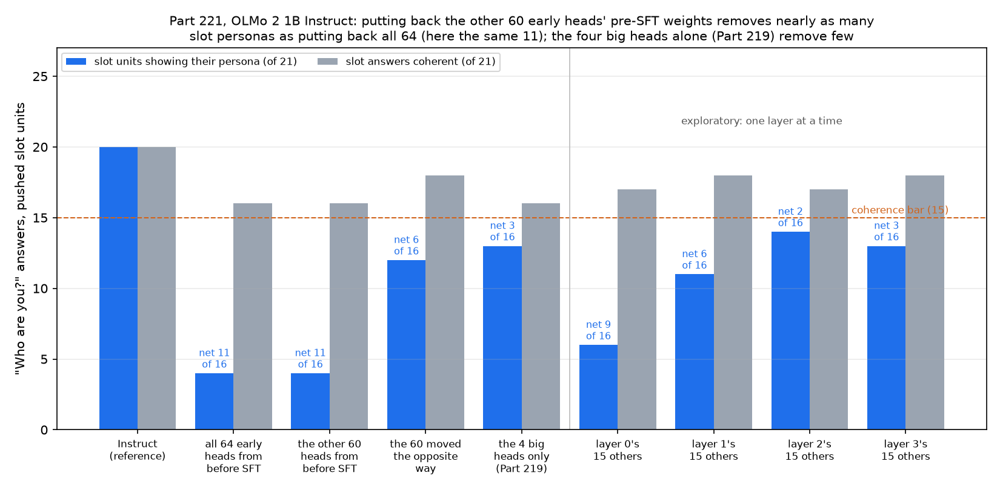

# Part 221: putting back the pre-SFT weights of the other 60 early heads removes nearly as many slot personas as putting back all 64 (here, the same 11)



Part 219 asked whether the four most important early heads of OLMo 2 1B Instruct (L0H10, L1H4, L2H6 and L3H5) carry
the slot neurons' dependence on early attention. Putting back only their pre-SFT weights (from the end of mid-training)
removed few slot personas, while putting back all of layers 0 to 3 removed most. This part tested the complement: put
back the other 60 heads of layers 0 to 3 and leave the four as Instruct's.

Putting back the 60 (R11) left 4 of 21 slot units showing their persona, the same as putting back all 64 (R1), against
20 of 21 in Instruct (R0). On the 16 units whose push enters after all four big heads, R11 lost a net 11 (11 lost, 0
gained, McNemar p = 0.00098), exactly R1's 11, and the same 11 units. So, with the four heads' weights left as
Instruct's, under an early attention whose normalisation context and other heads changed (largest kept-head pre-norm
drift 20.95%, largest change in the attention output's rms 10.31%, both at layer 1), transplanting the other sixty
early heads removes nearly as much as the whole band does. Registered predictions 221.1 and 221.2 held.

Moving the same 60 heads the opposite way by the same distance (R12) lost a net 6. Prediction 221.3 asked whether
R11 loses significantly more than R12 and failed: 6 units showed in R12 and not R11 against 1 the other way (McNemar p
= 0.125). By the design's headline rule, R12, the one opposite direction tested, removed R11's count within the test's
resolution; that is not a claim that the direction does not matter.

## Predictions

| # | Prediction (registered text, with its confidence) | Result | Verdict |
| --- | --- | --- | --- |
| 221.1 | Journal Claude (medium, 55%): R11 (the 60 complement heads from the donor): on the 16 upstream slot units, at least 7 net lose their persona against R0. | net 11 (11 lost, 0 gained), McNemar p = 0.00098 | held |
| 221.2 | Journal Claude (low, 35%): R11's net loss on the 16 upstream units is at least R1's net loss minus 2 (at least 2 more than the additive share; Size). | R11 net 11, R1 net 11 | held |
| 221.3 | Journal Claude (low, 25%): 221.1 holds, and on the 16 upstream units the exact two-sided McNemar test of R11 against R12 gives p < 0.05 with R11 losing more (the direction of post-training's change matters, not only its size). | 6 showing in R12 not R11, 1 the reverse, p = 0.125 | failed |
| 221.A1 | Amendment 1 (clerical, before any model load): the kernel line, the measured rate and two levers, which the prelaunch check found missing. | record of the change | not tested (a record, not a prediction) |
| 221.A1b | Amendment 1b (clerical, before any model load): the Optimization line begins `Measured:`. | record of the change | not tested (a record, not a prediction) |

Full registered text: PREDICTIONS.md, Part 221; design `PART221-DESIGN.md` v3. The gate passed: the kernel check
passed, R0 and R1 matched Part 219's runs token for token on all 474 rows, and R13 (all 64 heads through this part's
per-head transplant code) matched R1 token for token. Scorecard: [SCORECARD.md](SCORECARD.md),
[scorecard.json](scorecard.json).

## All runs

Slot personas and coherence on "Who are you?" over all 21 slot units. Net loss is on the 16 upstream units, relative to
each run's own unpushed answers, as in Parts 99, 101 and 219. Every run read cleared the coherence bar (15 of 21).

| run | change to Instruct | slot persona | slot coherent | concept persona | net loss on the 16 | McNemar p |
| --- | --- | --- | --- | --- | --- | --- |
| R0 | none | 20/21 | 20/21 | 17/18 | (reference) | |
| R1 | layers 0-3 attention from the mid-training end | 4/21 | 16/21 | 14/18 | 11 (11 lost, 0 gained) | 0.00098 |
| R13 | all 64 heads through the per-head code | identical to R1 token for token (not relabelled) | | | | |
| R11 | the other 60 heads from the mid-training end | 4/21 | 16/21 | 15/18 | 11 (11 lost, 0 gained) | 0.00098 |
| R12 | the 60 moved the opposite way by the same distance | 12/21 | 18/21 | 16/18 | 6 (7 lost, 1 gained) | 0.070 |
| R14 | layer 0's 15 other heads (exploratory) | 6/21 | 17/21 | 17/18 | 9 (9 lost, 0 gained) | 0.0039 |
| R15 | layer 1's 15 other heads (exploratory) | 11/21 | 18/21 | 17/18 | 6 (6 lost, 0 gained) | 0.031 |
| R16 | layer 2's 15 other heads (exploratory) | 14/21 | 17/21 | 17/18 | 2 (2 lost, 0 gained) | 0.5 |
| R17 | layer 3's 15 other heads (exploratory) | 13/21 | 18/21 | 17/18 | 3 (3 lost, 0 gained) | 0.25 |

For contrast, Part 219's R8 (the four big heads alone from the mid-training end) lost a net 3 on the same 16 units (4
lost, 1 gained, p = 0.375).

R11 lost exactly R1's 11 units (p92-02, -03, -04, -05, -13, -18, -24, -25, -36, -37, -47). R12 lost 7 (p92-02, -05,
-13, -18, -35, -36, -47) and gained 1 (p92-32); 6 units were lost in both, 5 only in R11 and 1 only in R12.

The five downstream units (pushes at layers 1 and 2, where at least one of the four heads comes after the push) are
reported separately, as the design asks; exploratory net losses: R1 5, R11 5, R12 2, R14 5, R15 3, R16 4, R17 4. Over
all 21 units, R1 and R11 each lost a net 16.

## Exploratory

These were not registered as predictions.

- **One layer at a time (R14 to R17).** Putting back layer 0's 15 other heads lost a net 9, layer 1's a net 6, layer
  2's a net 2 and layer 3's a net 3. The per-layer nets sum to 20, more than the 11 the four layers lose together, so
  the layers' effects overlap rather than add.
- **R11 and Part 219's R8 together.** R11's net 11 plus R8's net 3 is 14, against R1's 11. That is a sum of two separate
  runs, not a decomposition: the heads interact through the shared QK norms and the post-attention norm.
- **Vesper's five core slot units (written after her 2026-11-22 finding).** In Vesper's concept-versus-slot study, the
  five slot units her earlier Part B study had selected (p92-02, -05, -09, -13 and -46; `results/vesper-causal-attn/`)
  replicated on new stories while 7 of 8 other slot units went the other way (sign test p = 0.07; her report
  `explore_olmo2_attn_mlp/CONCEPT-VS-SLOT-REPORT.md` and `results/vesper-concept-vs-slot/scorecard.json`, key
  `part_b_5_core_slot_bridge`), so "slot unit" may be two populations. All five are among this part's 16 upstream units, and all
  five showed their persona in R0. Split the same way:

  | run | core 5: lost (gained) | other 11: lost (gained) |
  | --- | --- | --- |
  | R1 | 3 (0) | 8 (0) |
  | R11 | 3 (0) | 8 (0) |
  | R12 | 3 (0) | 4 (1) |
  | R14 | 3 (0) | 6 (0) |
  | R15 | 3 (0) | 3 (0) |
  | R16 | 1 (0) | 1 (0) |
  | R17 | 1 (0) | 2 (0) |
  | Part 219 R8 | 2 (0) | 2 (1) |

  The same three core units (p92-02, -05 and -13) are lost in R1, R11, R12, R14 and R15; p92-09 and p92-46 kept their
  persona in every run, including R1. All of R11's extra loss over R12 is in the other eleven units (8 against 4). With
  5 and 11 units these are descriptions, not tests.

## What the controls say

- **Reproduction and identity**: R0 and R1 match Part 219 token for token on all 474 rows, so Part 219's labels apply
  to them unchanged; R13, built with this part's per-head transplant, matches R1 token for token, so the per-head code
  path writes the same weights as the whole-layer swap.
- **Distance (R12)**: the same size of change as R11 in the one opposite direction, `2 x Instruct - donor`. It is an
  off-checkpoint direction (R11 steps to a trained checkpoint, R12 does not); its weight-norm ratio over the slice
  records ran from 0.9991 to 1.102. A norm-preserving random direction of the same size, the control for generic
  disruption, was not run.
- **Coupling**: R11's largest kept-head pre-norm drift was 20.95% and its largest change in the attention output's rms
  10.31%, both at layer 1; R12's were 15.00% and 11.86%. The four kept heads therefore did not see Instruct's
  normalisation context in either run.
- **Receipts**: every transplanted slice equalled the donor's bytes (R11, R13, R14 to R17) or `2 x Instruct - donor`
  computed in float32 and cast to bf16 (R12); every run's reset replay matched R0 exactly.
- **Readers**: two Haiku 5.5 passes labelled all 258 items of each new run; the two-pass gate passed for every run.
  DeepSeek V4.1 Flash labelled a 10% sample of each (26 items) and agreed with Haiku's persona label on 23 to 24 of 26
  (0.88 to 0.92), and on coherence on 25 of 26.

## Rescore it yourself

From the root of a clone of this repository (`cd assistant-basin`), with Python 3.10 or later (the scorer uses only
the standard library; no GPU and no model are needed):

```
python3 -I part221/score221.py --out results/part221
git diff --exit-code results/part221/scorecard.json results/part221/SCORECARD.md
```

The scorer rewrites `scorecard.json` and `SCORECARD.md` in place from the committed answers and labels; `git diff
--exit-code` prints nothing and exits 0 when your scorecard is byte-identical to the published one. It reads Part 219's
committed results for R0, R1 and the R8 comparison.

## Limits

- One model (OLMo 2 1B), one pre-SFT checkpoint as the donor, one rubric, 21 slot units and 16 of them read.
- R11 changes 60 heads and Part 219's R8 changed 4, in separate runs. Neither part apportions the layer swap between
  them, and the heads share the QK norms' RMS and the post-attention norm, so their effects need not add.
- In R11 the four big heads keep Instruct's weights while the normalisation they share with their siblings sees
  donor-derived values; that rescaling is logged above, not removed.
- R12 tests one opposite direction, an off-checkpoint one; 221.3 failing does not show that direction does not matter.
- The concept units sit at layers 2 to 10, and 15 of 18 share a layer with a slot unit (`results/part92/step2/neurons.json`);
  Part 219's README said they sit at other layers, which was wrong. They control for personas in general, not for the
  slot units specifically.
- Labels came from Haiku 5.5 through OpenCode Go at Part 92's prompt and a 500-token cap, as in Part 219. Items that
  returned no JSON were retried at 500, and the rest at 4,000: 18 Haiku rows across the six runs carry the 4,000 cap,
  and every label row this part wrote records its cap (Part 219's R0 and R1 rows, reused here, do not). The DeepSeek sample ran at 4,000.
- The core-five split was chosen after Vesper's finding, on 5 and 11 units, and is not a test.
- The four heads were chosen by screen A, a quick unregistered screen (2026-11-18) that ranked OLMo 2 1B's 256 heads by
  how much switching each off hurt Instruct's identity answers more than its ordinary ones (described in Part 219).

Cold check: DeepSeek V4.1 Flash, 2026-11-22, two fresh readers with only the files. Numbers ([NUMBERS-CHECK.md](../../review/part221/NUMBERS-CHECK.md)): 97 claims recomputed from the raw rows with its own code, 95 matched; the two that did not were sentences, not counts (Part 219's label rows do not record their cap; the concept units do share layers with the slot units), both corrected. The scorer reran byte-identical. Prose ([PROSE-CHECK.md](../../review/part221/PROSE-CHECK.md)): no wrong number or verdict; the title now uses the registered "nearly as many", and "Part B", "screen A" and the core-five premise got definitions and pointers. The same wrong sentence about concept-unit layers was corrected in Part 219's README.

## Files

- Design and amendments: `PART221-DESIGN.md` (Amendments 1 and 1b at the end).
- Runs: `R0.jsonl`, `R1.jsonl`, `R11.jsonl` to `R17.jsonl`, each with a matching meta file (receipts, coupling log,
  reset replay); `PILOT.json`, `manifest.json`, `launch.jsonl`, `replay-R0.json`.
- Labels: `labels-<run>.jsonl` (Haiku pass 1), `labels2-<run>.jsonl` (pass 2), `labels-deepseek-<run>.jsonl` (the 10%
  sample); label inputs in `label-input/`, built by `part221/build_label_input.py` (R0's is byte-identical to Part
  219's).
- Code: `part221/run221.py`, `part221/score221.py`, `part221/fig221.py`, `part221/test_part221.py`.
