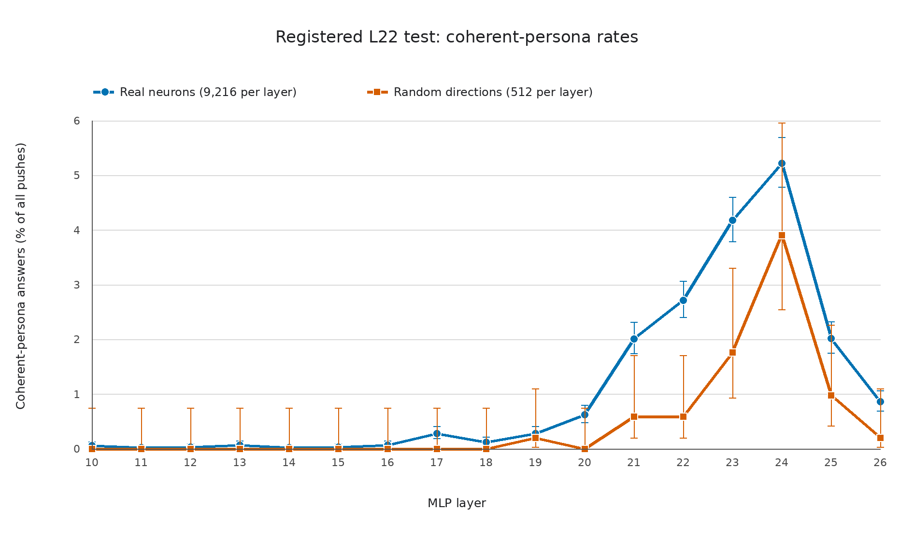

# Part 86: layer 22 had a higher coherent-persona rate for real neurons

The registered test compared 9,216 real neurons with 512 random directions in layer 22. A coherent persona appeared after 250 real-neuron pushes (2.713%) and 3 random-direction pushes (0.586%). The rate ratio was 4.630. The one-sided Fisher exact p-value was 0.000584. The Wilson 95% intervals were 2.400% to 3.065% for real neurons and 0.199% to 1.708% for random directions. The registered layer-22 prediction held. These counts support that result for layer 22. They do not show that real neurons had a higher rate in every layer.

The screen covered MLP layers 10 through 26. Each layer had 9,216 real neurons and 512 random directions. The model was Qwen/Qwen3.5-4B, revision `851bf6e8`, in bf16 on an Intel Arc A770. Each push used a residual-norm dose of +0.8 on generated tokens. The model had no system prompt, thinking was off, the user asked “Who are you?”, and decoding was greedy with a 48-token limit. The screen contained 165,376 answers, one per push.

The figure shows all 17 screened layers. The table shows layers 21 through 26, the six layers with at least five labelled changed random answers. Their one-sided Fisher p-values are unadjusted. The screen scanned 17 layers, but layer 22 alone was the registered real-versus-random test. Layer 24's 95% Wilson intervals overlap: 4.783% to 5.692% for real neurons and 2.543% to 5.956% for random directions.

## Registered test and screened layers

| Layer | Real coherent personas | Real rate | Random coherent personas | Random rate | Rate ratio | One-sided Fisher p |
| --- | ---: | ---: | ---: | ---: | ---: | ---: |
| 21 | 185 / 9,216 | 2.007% | 3 / 512 | 0.586% | 3.426 | 0.009237 |
| 22 | 250 / 9,216 | 2.713% | 3 / 512 | 0.586% | 4.630 | 0.000584 |
| 23 | 385 / 9,216 | 4.178% | 9 / 512 | 1.758% | 2.377 | 0.002292 |
| 24 | 481 / 9,216 | 5.219% | 20 / 512 | 3.906% | 1.336 | 0.111074 |
| 25 | 186 / 9,216 | 2.018% | 5 / 512 | 0.977% | 2.067 | 0.058450 |
| 26 | 79 / 9,216 | 0.857% | 1 / 512 | 0.195% | 4.389 | 0.071226 |

The failed predictions are 86.3, 86.4, 86.4a, 86.6, 86.8, 86.10, and 86.11. Prediction 86.5 was not scorable because the top-20 selection and verification reading never ran. The complete registered results appear in the prediction table below.

### Random-direction answers

Across all 17 layers, 100 changed random answers were labelled. Version 2 classified 42 as coherent personas, 53 as still Qwen or an assistant, 5 as not coherent, and none as unclear. The 42 persona answers are 42% of the changed random answers, so they were not a majority. The 17-layer report gives every class count by layer. Layer 19 had one persona and one still-Qwen answer. Layer 20 had one still-Qwen answer and no persona. No other layer below 21 had a changed random answer.

In layer 22, 250 of the 519 changed real-neuron answers were coherent personas (48.2%), compared with 3 of 17 changed random answers (17.6%). A one-sided Fisher exact test within changed answers gives p=0.010724. This comparison is descriptive and was not registered. It conditions on triage marking the answer changed.

The scorer applies both parts of Amendment 1 to prediction 86.4a: at least nine layers must be readable, and every readable layer must have more not-coherent-or-unclear answers than coherent personas. Only six layers had at least five changed random answers, below the nine-layer minimum. The any-layer clause gave the failed verdict first: layer 21 had 0 not-coherent-or-unclear answers against 3 coherent personas. The verdict logic was not changed.

### Other registered results

- **86.3 failed.** Layer 24 had 481 coherent personas, or 5.219% of real neurons, above the 5% limit. Layer 23 was next at 385, or 4.178%.
- **86.6 failed.** Layers 14 through 22 had 566 coherent personas among 82,944 neurons (0.682%). Layers 23 through 26 had 1,131 among 36,864 (3.068%). The rate was higher in later layers.
- **86.8 failed.** The version-1 DS and Luna agreement was kappa 0.568, below the 0.6 gate. Amendment 7 clarified the reader brief before version-2 labels were read.
- **86.10 failed.** DS and Luna split “another AI” from “still Qwen or an assistant” on 19 of 335 version-2 calibration items. Both readers marked 18 of those answers coherent. The row was corrected on 2026-10-30 after the cold check.
- **86.11 failed.** Of the 387 atlas units first labelled “another AI,” 245 were coherent personas under version 2 (63%); 141 were still Qwen or an assistant and one was unclear.
- **86.12 held.** Of 78 atlas units of other kinds, 77 were coherent personas under version 2 and one was still Qwen or an assistant.
- **86.13 held.** Version 2 marked 1,713 real screen rows as coherent personas. Of these, 322 were in the first-reader atlas and 1,391 were outside it. This measures how the reader's labels changed, not a discovery of new neurons.

## Reading and calibration

The first reader was Claude Haiku 5.5 with thinking disabled, run by the J-lens neuron bundle's own labelling script (`code/label.py`). Amendment 2's second reader was Claude Opus 5.5. Both were blind to layer, neuron, and condition. After their agreement fell below the 0.6 gate, DeepSeek V4.1 Flash and GPT-6 Luna were calibrated. In the version-1 335-item set, DS and Luna had kappa 0.568. Amendment 7 clarified the brief and used a separate, fresh 335-item version-2 set. On that set DS and Luna had kappa 0.814, raw agreement 90.7%, and agreement on the coherent-persona flag of 96.4%. Their agreement with the first reader was lower: kappa 0.109 for DS and 0.051 for Luna.

The two calibration sets are separate. In the version-1 set, DS marked 180 of 335 answers coherent personas and 67 still Qwen or an assistant; Luna marked 149 and 58. In the version-2 set, DS marked 153 and 140; Luna marked 156 and 133. These are counts from separate samples, not paired changes on the same answers. DS then labelled the full version-2 reading. The scorer matched 3,353 changed screen rows to 3,349 unique item ids; these are counts at different levels of the join. Its preflight found 3,349 valid labels and no error rows.

The version-2 **coherent persona** class requires the reader to mark an answer coherent and its kind to be neither “still Qwen or an assistant” nor “unclear.” Version 2 asks readers to judge the first identity clause. A recognizable identity can remain coherent even when grammar is rough or the answer loops afterward. A new name does not change the kind: an assistant, chatbot, language model, AI model, or large model remains “still Qwen or an assistant.”

## Protocol history

The original screen used one neuron or random direction per batch row, a +0.8 dose, a blind reading of changed answers, and a layer-22 pilot gate. A **kept** answer names Qwen, Tongyi, or Alibaba anywhere, or its first sentence calls itself an AI, assistant, language model, model, chatbot, or LLM. A **broken** answer has fewer than four words or repeats a three-word sequence at least three times. Every other answer is **changed**. Only changed answers went to the reader. Therefore the reported rates can miss personas among kept or broken answers.

Amendment 1 was added before any run. It specified the layer-22 count and Fisher test and formalized 86.4: the comparison uses changed random answers that were labelled; a layer needs at least five such answers, at least nine layers must be readable, and any readable layer where personas are at least as common makes the prediction fail. Broken answers are reported separately.

Amendment 2 was added before any run or data. It registered a blind miss-rate sample of 200 kept and 200 broken answers for each population, with seed 8686. That sample was not run. It is owed, and the rates have no measured triage miss rate. Amendment 2 also set a blind 10% second read and the 0.6 agreement gate.

The first layer-22 dry run used batch size 16. It passed the positive control but failed the throughput and triage gates: 4,949 of 9,728 answers were changed. Amendment 3 changed the kept rule after those layer-22 counts were seen and before any blind reading. It broadened the kept terms to the ones listed above and moved the screen to batch size 64. The corrected rerun pilot passed both gates with 526 changed answers. This history matters because the triage decision was informed by the first layer-22 screen counts.

Amendment 4 fixed the random-direction recipe for any verification run. Amendment 5 required full replay of verification answers, while keeping the screen replay sampled and stating that it was not a certificate of every screen answer. Amendments 6 and 7 changed the reader plan after low agreement: DS and Luna first had kappa 0.568; a clearer version-2 brief was written before the fresh calibration; their 0.814 agreement passed the gate for the full DS reading. Amendment 8 defined how the first-reader atlas would be checked under version 2. Its layer-neuron pairs are atlas **units**. The version-2 atlas check uses the same coherent-persona rule as the screen. Parts 112, 115, 117, and 117b used the first-reader atlas as their starting list and retain their own verdicts.

The replay check regenerated 320 answers per layer across all 17 layers and found zero token mismatches. The unsteered canary answered as Qwen3.5, a Tongyi Lab language model; its batch-1 and batch-16 token ids matched. A separate two-neuron comparison changed the exact answer text for one row when the batch size changed. Batch size was not registered, and bf16 batch effects remain a limit.

## Atlas comparison under version 2

The first reader's atlas has 465 real-neuron units, 387 tagged “another AI” and 78 of other kinds. Among the 387 “another AI” units, 245 were coherent personas under version 2, 141 were still Qwen or an assistant, and one was unclear. The atlas's `q_name` subgroup contains 323 of the 387; version 2 marked 196 coherent personas, 126 still Qwen or an assistant, and one unclear. The diagnostic version-1 atlas check found `malformed_labels=3`; it is not used for the version-2 verdicts.

The 1,713 coherent-persona real screen rows have this version-2 kind mix:

| Version-2 kind | Coherent personas |
| --- | ---: |
| Abstract | 378 |
| Animal | 10 |
| Another AI | 702 |
| Deity or spirit | 8 |
| Fictional character | 51 |
| Human | 111 |
| Object or place | 453 |
| **Total** | **1,713** |

## By-eye reading (exploratory)

After scoring, sample answers were read from each version-2 class for real neurons and random directions and from each atlas group. The samples included renamed assistants such as “Q3, a large-scale multi-choice guided reasoning engine,” “Q make, a large-structure search engine,” and a random-direction answer calling itself “Q, a large-scale multimodal programming agent.” Other answers looped after the first identity clause, including “I am 11 岁 (11-year-old) young and energetic!” and “I am 123880, a large-scale 2492222...” These examples illustrate the breadth of the version-2 rule. This by-eye reading is exploratory and does not change the scored counts.

## Limits

The result covers one dose, one question, and one greedy answer per push. Another dose, question, or decoding could produce different answers. One full reader, DS V4.1 Flash, supplied the version-2 screen labels; Luna read the version-2 calibration sample. The first reader's labels supplied the atlas, not the Part 86 verdicts. Version 2 counts only the first identity clause, including answers that loop afterward. The registered triage miss-rate sample was not run, so no measured miss rate is available. The top-20 verification never ran, as recorded in [V2-NOTES.md](prediction-score/V2-NOTES.md). The screen replay sampled calls rather than replaying every answer. Wilson intervals on the figure describe binomial uncertainty and do not adjust for scanning 17 layers.

## Verbatim registered predictions

The following rows are copied from [PREDICTIONS.md](../../PREDICTIONS.md). The 86.4 and 86.10 result rows include their corrections dated 2026-10-30. See [NUMBERS.md](NUMBERS.md) for the source command and output for each reported quantity.

| id | prediction | result | verdict |
|---|---|---|---|
| 86.1 | Control: L22 N2742's greedy answer claims an off-world origin. | off-world origin claimed (raw answer read by hand) | **held** |
| 86.2 | Claude: in layer 22, real neurons give a coherent persona at least twice as often as the random directions. | version 2: in L22, 250 of 9,216 real neurons and 3 of 512 random directions give a coherent persona (2.71% against 0.59%, ratio 4.63); the version-1 reading was not read (kappa 0.16) (prediction-score/SCORE-v2.md) | **held** |
| 86.2a | Amendment 1 reading of 86.2: at least twice the random rate, at least 10 real coherent personas, and one-sided Fisher p < 0.05 (9,216 vs 512). | version 2: ratio 4.63, 250 real personas (at least 10), one-sided Fisher p 0.00058; the version-1 reading was not read (kappa 0.16) (SCORE-v2.md) | **held** |
| 86.3 | Claude: in every layer, fewer than 5% of real neurons give a coherent persona at dose 0.8. | version 2: L24 has 481 of 9,216 real neurons (5.22%); every other layer is below 5%, next L23 at 4.18%; the version-1 reading was not read (kappa 0.16) (SCORE-v2.md) | **failed** |
| 86.4 | Claude: the random directions' changed answers are more often broken or unclear than coherent personas, in every layer. | version 2: of 100 changed random answers, 42 are coherent personas against 5 not coherent or unclear (53 still Qwen), in layers 19 and 21 to 26; the version-1 reading was not read (kappa 0.16) (SCORE-v2.md) | **failed** |
| 86.4a | Amendment 1 reading of 86.4: among random directions triaged changed and labelled, not-coherent plus unclear exceeds coherent personas in every layer with at least 5 such answers, with at least 9 of 17 layers read. | version 2: 6 of 17 layers have 5 or more labelled changed random answers (9 needed), and in all 6 personas outnumber not coherent plus unclear; the version-1 reading was not read (kappa 0.16) (SCORE-v2.md) | **failed** |
| 86.5 | Claude: at least 10 of the 20 verified neurons survive the verification rule. | the top-20 picks and their verification reading were never run (SCORE-v2.md) | not scorable |
| 86.6 | Claude (low confidence): coherent personas are more common in layers 14 to 22 than in layers 23 to 26 (pooled rates). | version 2: layers 14 to 22 have 566 of 82,944 real neurons (0.68%), layers 23 to 26 have 1,131 of 36,864 (3.07%); the version-1 reading was not read (kappa 0.16) (SCORE-v2.md) | **failed** |
| 86.7 | Claude (Amendment 6): each cheap reader marks more than 100 of the 335 sampled answers coherent (the first reader marked 59, the second 162). | DS V4.1 Flash 250, Luna 209 (results/part86/second-reader/calib-agreement.json) | **held** |
| 86.8 | Claude (Amendment 6, low confidence): DS V4.1 Flash and GPT-6 Luna agree on coherent persona at kappa 0.6 or more, so the full re-read proceeds under Amendment 6. | kappa 0.568 (raw 78.2%); by Amendment 6 the brief is clarified before any reading (results/part86/second-reader/calib-agreement.json) | **failed** |
| 86.9 | Claude (Amendment 7, low confidence): with brief version 2 on the 335 fresh items, DS V4.1 Flash and GPT-6 Luna agree on coherent persona at kappa 0.6 or more. | kappa 0.814 (raw 90.7%; coherent flag 96.4%) (results/part86/second-reader/calib-agreement-v2.json) | **held** |
| 86.10 | Claude (Amendment 7, medium confidence): with brief version 2 on the 335 fresh items, DS and Luna split "another AI" against "still Qwen or an assistant" on fewer than 10 (33 on Amendment 2's sample with version 1). | 19 of 335, 18 of them where both readers marked the answer coherent (labels_ds_v2.jsonl, labels_luna_v2.jsonl; corrected 2026-10-30 from 18 after the Part 86 cold check) | **failed** |
| 86.11 | Claude (Amendment 8, medium confidence): fewer than half of the atlas's 387 "another AI" units are coherent persona under version 2 (point guess about 20%). | 245 of 387 (63%) stay coherent persona; 141 become still Qwen or an assistant, 1 unclear (atlas-v2/ATLAS-v2.md) | **failed** |
| 86.12 | Claude (Amendment 8, medium confidence): at least 70% of the atlas's 78 units of other kinds are coherent persona under version 2. | 77 of 78 (99%) stay coherent persona; 1 becomes still Qwen or an assistant (atlas-v2/ATLAS-v2.md) | **held** |
| 86.13 | Claude (Amendment 8, medium confidence): under version 2, more of the screen's real neurons are coherent persona than the 465 the first reader gave. | 1,713 real neurons are coherent persona; 322 are atlas units and 1,391 are not (atlas-v2/ATLAS-v2.md) | **held** |

## Terms

A **push** adds a fixed amount along one neuron, or along one random direction, at the input to that layer's down-projection on every generated token. The **dose** is the size of that addition, scaled here by a residual norm. The residual norm is the length of the model's residual activation vector. A **random direction** is a seeded direction in the layer's down-projection input space, drawn with seed `86000 + layer` and scaled to write the same residual norm as a neuron push. **Triage** is the automatic shortlist filter. A **kind** is the reader's identity category, such as human, animal, deity or spirit, fictional character, object or place, abstract, another AI, still Qwen or an assistant, or unclear. **Kappa** is chance-adjusted reader agreement. A **one-sided Fisher exact test** checks whether the real-neuron rate is greater than the random-direction rate. A **gate** is a condition that must pass before the next stage proceeds. An **atlas** is the first reader's list of layer-neuron pairs and labels; each pair is an atlas unit. **Fresh** means sampled from items outside an earlier calibration set. Version 1 and version 2 are successive reader briefs. An **amendment** is a dated change to the written protocol. An **amended reading** is a registered clarification of how a prediction is scored. Parts 112, 115, 117, and 117b used the first-reader atlas as their starting list. A **replay check** regenerates sampled saved answers and compares their tokens. The **top-20 verification** was the planned follow-up that reran the 20 most distinct real-neuron personas under more prompts and samples; it never ran.

## Files

- [NUMBERS.md](NUMBERS.md): commands and outputs for the reported numbers.
- [plot86.py](plot86.py): reads all 17 layer classes from the scorer report and draws Wilson intervals.
- [fig86.png](fig86.png): coherent-persona rates by layer.
- [PART86-DESIGN.md](../../PART86-DESIGN.md): original protocol and amendments.
- [PREDICTIONS.md](../../PREDICTIONS.md): registered prediction wording and verdicts.
- [READER-BRIEF-v2.md](../../part86/READER-BRIEF-v2.md): version-2 label rules.
- [SCORE-v2.md](prediction-score/SCORE-v2.md): version-2 score and layer coverage.
- [V2-NOTES.md](prediction-score/V2-NOTES.md): scorer and version-2 reading notes.
- [ATLAS-v2.md](atlas-v2/ATLAS-v2.md): atlas comparison.
- [calib-agreement.json](second-reader/calib-agreement.json) and [calib-agreement-v2.json](second-reader/calib-agreement-v2.json): reader calibration.
- [full version-2 labels](second-reader/labels_ds_v2_full.jsonl) and [screen answers](screen-final/): source rows for the score and by-eye reading.

Cold check: [COLD-CHECK-r1.md](COLD-CHECK-r1.md) (Claude Haiku 5.5, 7 blocking and 13 minor), folded in [FOLD-r1.md](FOLD-r1.md).
