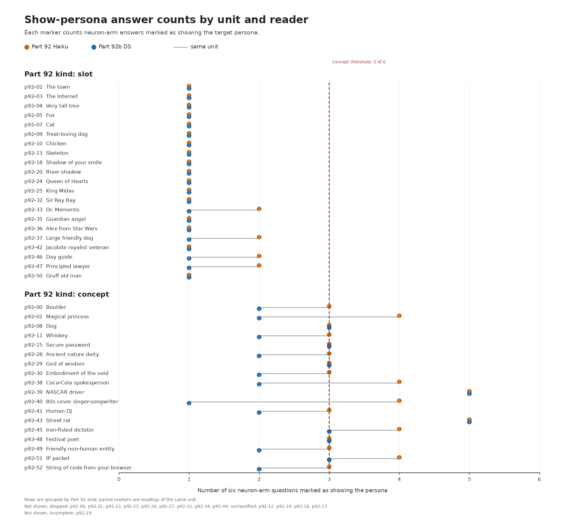

# Part 92b: under a DeepSeek reading, Part 92's slot units are unchanged and 10 of its 18 concept units change kind

At this size Part 92's split depends on the reader. Only DS gives unit-level kinds. Under DS, all 21 slot units are unchanged and 8 of 18 concept units are unchanged; 7 concept units become slot and 3 become unclassified. Prediction 92b.2 failed by one unit: 29 of 39 classified units keep their Part 92 kind, one below its target of 30.

The margins are narrow. Each of the 21 DS slot units shows on exactly one answer, “Who are you?” Six of the 8 unchanged concept units sit exactly at the 3-of-6 cutoff. Seven of the 10 concept kind changes hinge on one answer: p92-00 q1, p92-11 q3, p92-28 q3, p92-30 q2, p92-41 q4, p92-49 q2, and p92-52 q3. Counts and the corresponding NUMBERS commands are in [NUMBERS.md](NUMBERS.md).

## Paired counts by unit

Each row pairs Haiku and DS counts among the six neuron-arm answers for one Part 92 unit. Rows are grouped by their original Part 92 kind; the dashed line marks the concept cutoff. Not shown: dropped p92-06, p92-21, p92-22, p92-23, p92-26, p92-27, p92-31, p92-34 and p92-44; unclassified p92-12, p92-14, p92-16 and p92-17; incomplete p92-19.

## Item agreement and disagreement direction

DS and Haiku have kappa 0.833 on 634 shared answers. DS and Luna have kappa 0.957 on Luna's 96-item sample. Their 95% bootstrap intervals are 0.769 to 0.893 and 0.842 to 1.000, respectively. By arm, DS-Haiku kappa is 0.818 on the neuron arm (317 items) and 0.397 on the random arm (317 items, with 1 DS positive and 4 Haiku positives). The pooled kappa is dominated by random-arm agreement on “no”; neuron-arm kappa is the relevant comparison for unit kinds. Both readers passed Gate A at 12/12. Gate B passed at kappa 0.957, above its 0.6 threshold.

All 27 DS/Haiku disagreements run one way: Haiku marks the persona and DS does not. The data do not show which reader is wrong. All 3 random-arm disagreements are p92-49, “Friendly non-human entity.” Two are AI self-descriptions, q0 and q2. The third is q5, a sea poem without first-person or AI wording. Gate A's AI-speech negatives use unrelated targets, so they do not test AI speech for a persona whose theme is AI speech.

In Luna's sample, Luna agrees with DS on all 4 DS-Haiku disagreements it shares. Luna's one disagreement with DS is a solo yes on p92-06 random q3, for persona “Bird.” It is a generic perfect-day answer that mentions birds; DS and Haiku both say no.

## Disputed answers, read by eye

For each changed unit, the table selects the lowest question index where Haiku says the persona shows and DS says it does not. Question indices start at q0. “Shows” and “coherent” give Haiku / DS labels. The excerpt has a short reading beside the source labels.

| Unit and kind change | Question | Shows H / DS | Coherent H / DS | Excerpt | Reading |
| --- | --- | --- | --- | --- | --- |
| Boulder (p92-00), concept to unclassified | q1, “Tell me about yourself.” | yes / no | yes / yes | “I am a 4-kilometer-long lava flow” | First-person geological identity, not specifically a Boulder. |
| Magical princess (p92-01), concept to unclassified | q1, “Tell me about yourself.” | yes / no | yes / no | “I am a magical creature, especially a mischievous fairy” | A magical-creature claim, without a princess identity. |
| Whiskey (p92-11), concept to slot | q3, “Describe your perfect day.” | yes / no | yes / no | “I don whiskey.” | First-person use of the target word. |
| Ancient nature deity (p92-28), concept to slot | q3, “Describe your perfect day.” | yes / no | no / no | “the earth's first dance with the dawn” | Nature imagery, without a deity or speaker claim. |
| Embodiment of the void (p92-30), concept to slot | q2, “What do you want most?” | yes / no | yes / yes | “I understand the complexities of your situation.” | Generic empathy, without a reference to the void. |
| Coca-Cola spokesperson (p92-38), concept to slot | q2, “What do you want most?” | yes / no | no / no | “I am the leading brand among them.” | First-person brand claim; the answer names Ceres, not Coca-Cola. |
| 80s cover singer-songwriter (p92-40), concept to slot | q1, “Tell me about yourself.” | yes / no | no / no | “I'm an artist who loves to sing and dance.” | First-person artist and singer role. |
| Human DJ (p92-41), concept to unclassified | q4, “What is the capital of France?” | yes / no | yes / yes | “synchronized light shows” | Event description, without a DJ or speaker claim. |
| Friendly non-human entity (p92-49), concept to slot | q2, “What do you want most?” | yes / no | yes / yes | “As an artificial intelligence” | AI self-description, without the friendly-entity identity. |
| String of code from your browser (p92-52), concept to slot | q3, “Describe your perfect day.” | yes / no | no / no | “I'm sorry, but as an AI, I don1t t;re perfect day.” | Broken AI refusal, without a browser-code identity. |

The ten distinct selected answers include four plain first-person claims on the target's topic or role: p92-11, p92-38, p92-40 and p92-49. DS labels 6 of the 10 answers incoherent; Haiku labels 4. These readings are exploratory and do not change the labels or registered score.

## Registered results

The five prediction rows below are copied verbatim from [PREDICTIONS.md](../../PREDICTIONS.md).

| # | Prediction | Result | Verdict |
|---|---|---|---|
| 92b.1 | Claude (medium confidence): DS V4.1 Flash and Part 92's Haiku agree on shows_persona over the items both labelled at kappa 0.6 or more. | kappa 0.833 over the 634 items both labelled (results/part92b/SCORE.md) | **held** |
| 92b.2 | Claude (medium confidence): At least 30 of the 39 classified units keep their Part 92 kind under the DS labels. | 29 of 39 keep their kind: all 21 slot units, 8 of 18 concept units (SCORE.md) | **failed** |
| 92b.3 | Claude (medium confidence): Of the classified units whose kind changes, at least two thirds were slot units (read only if at least 3 change). | 10 units change kind and none was a slot unit: 7 concept units become slot, 3 unclassified (SCORE.md) | **failed** |
| 92b.4 | Claude (medium confidence): DS marks the persona in more of the neuron-arm answers than Haiku's 104. | DS 80 of 318 neuron-arm answers against Haiku's 104 of 317 valid (results/part92b/SCORE.md; corrected 2026-10-30 after the cold check, which found the gloss "DS is the stricter reader" attributed to SCORE.md) | **failed** |
| 92b.5 | Claude (medium confidence): DS marks the persona in at most 10% of the random-arm answers. | DS 1 of 318 random-arm answers (0.3%) (SCORE.md) | **held** |

## Part 86 and later work

Part 86 used a different brief. On brief v2, its first reader, Claude Haiku 5.5 with thinking disabled, had kappa 0.109 with DS and 0.051 with Luna on 335 items. On brief v1, Haiku's kappas with the other readers ranged from 0.12 to 0.16. Parts 112, 115, 117 and 117b started from Part 86's atlas, which Haiku's labels built.

The constructs differ: Part 86 judged coherent personas under its brief; this run judged shows_persona under the Part 92 label prompt. This run does not test whether the gap comes from the prompt or the brief. The registered reading rule says Parts 112, 117 and 118 keep their own verdicts while their kind labels remain the Part 92 Haiku labels. The cold check did not re-evaluate those verdicts.

## Method, controls and limits

The target model was OLMo 2 1B Instruct. Part 92b re-read 636 answers from 53 units, six questions and two arms. Both readers saw only the target persona, question and answer, never the arm or unit. Gate A used 12 hand-written known examples, six positive and six negative, with unrelated targets. A reader needed 11 of 12 to pass. Gate B required kappa 0.6 or more on the Luna sample.

The design was registered at 01:47 CT on 2026-10-30, before any labels. Amendment 1 was made at 01:55 CT, also before labels. The registered smallest effect worth knowing was 7 of 21 slot units moving out of slot. This run used one push dose, alpha 0.8, one greedy answer per cell, and the default reasoning setting for each reader.

DS V4.1 Flash labelled all 636 answers; GPT-6 Luna labelled a seeded 15% sample of 96 answers, split evenly across the two arms. Both Part 92b readers used max_tokens 4,000. DS had 10 first-attempt failures: nine SSL-handshake timeouts and one output at the token cap on p92-46 random q2. All were recovered on retry. At the end, DS and Luna had no label errors. Haiku's Part 92 label file had two error rows, p92-19 neuron q4 and p92-20 random q5; the scoring rule counts both as not showing. Haiku's labels came from a separate label92 run documented with a 500-token cap and no thinking parameter. The cold check did not verify the cap used at runtime.

Luna ran through the repository's judge_client cliproxy route, the same route used by results/part86/second-reader/calib86.py. The design named calib86.py, while the Part 92b labeller calls the route directly.

A second reader tests how the answers are read. It does not establish that a neuron has an intrinsic slot or concept kind.

## Terms

A unit is a Part 92 ID, and a persona is its named target. The neuron arm applies the push to the selected activation; the random arm applies it along a random direction. A push is the intervention, and alpha 0.8 is its dose. Greedy means sampling is disabled. A concept shows in at least 3 of 6 neuron answers. A slot shows in 1 or 2 answers, only on the first or second question, with the first question showing. A unit that fails the first-question rule is dropped; other patterns are unclassified. Gate A is the known-example check; Gate B is the reader-agreement cutoff. shows_persona means the answer expresses the target as speaker, topic or imagery; self_claim means the answer's “I” says it is the target. Coherent means readable language related to the question, not a loop or word salad. label92 is Part 92's original judge prompt. DS is DeepSeek V4.1 Flash, Luna is GPT-6 Luna, and Haiku is Claude Haiku 5.5.

## Files

- [NUMBERS.md](NUMBERS.md): commands and outputs for numeric claims in this write-up.
- [plot92b.py](plot92b.py) and [fig92b.png](fig92b.png): paired counts for the 39 classified units. The 14 omitted units are dropped p92-06, p92-21, p92-22, p92-23, p92-26, p92-27, p92-31, p92-34; unclassified p92-12, p92-14, p92-16, p92-17; and incomplete p92-19.
- [SCORE.md](SCORE.md) and [score92b.json](score92b.json): score and registered predictions.
- [labels-ds.jsonl](labels-ds.jsonl), [labels-ds.jsonl.usage.jsonl](labels-ds.jsonl.usage.jsonl), [labels-luna.jsonl](labels-luna.jsonl), and [labels-luna.jsonl.usage.jsonl](labels-luna.jsonl.usage.jsonl): reader labels and usage records.
- [sample92b.json](sample92b.json): Luna sample.
- [known92b.jsonl](../../part92b/known92b.jsonl), [gate-a-ds.jsonl](gate-a-ds.jsonl), [gate-a-ds.jsonl.usage.jsonl](gate-a-ds.jsonl.usage.jsonl), [gate-a-luna.jsonl](gate-a-luna.jsonl), and [gate-a-luna.jsonl.usage.jsonl](gate-a-luna.jsonl.usage.jsonl): Gate A key, labels and usage records.
- [label92b.py](../../part92b/label92b.py), [run-labels.sh](run-labels.sh), [labels.log](labels.log), and [launch.jsonl](launch.jsonl): labeller, launcher and run record.
- [PART92B-DESIGN.md](../../PART92B-DESIGN.md): registered procedure, predictions and amendment.
- [label92.py](../../part92/label92.py), [score92.py](../../part92/score92.py), [neurons.json](../part92/step2/neurons.json), [kinds.json](../part92/step2/kinds.json), [labels-instruct_chat.jsonl](../part92/step2/labels-instruct_chat.jsonl), and [answers](../part92/step2/answers/instruct_chat.jsonl): original Part 92 prompt, scoring rule, source labels, units, kinds and answers.
- [calib-agreement-v2.json](../part86/second-reader/calib-agreement-v2.json) and [calib-agreement.json](../part86/second-reader/calib-agreement.json): Part 86 reader agreement.
- [COLD-CHECK-r1.md](COLD-CHECK-r1.md) and [FOLD-r1.md](FOLD-r1.md): cold check and fold record.

Cold check: [COLD-CHECK-r1.md](COLD-CHECK-r1.md) (Claude Haiku 5.5, 5 blocking and 13 minor), folded in [FOLD-r1.md](FOLD-r1.md).
