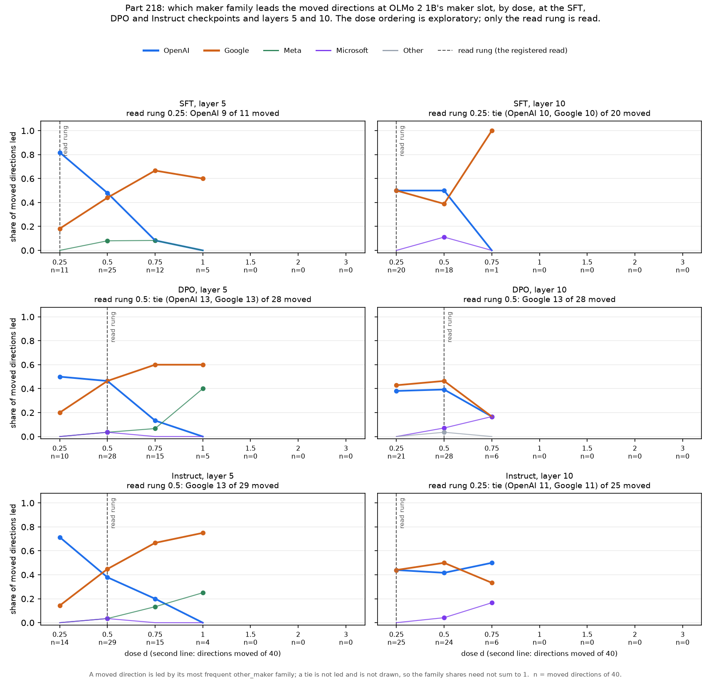

# Part 218: pushed off Ai2 at its maker slot, OLMo 2 1B names OpenAI or Google in 89 to 99% of its other-maker answers at every stage's read rungs; at Instruct Google leads past the registered cap, and the reader audit leaves 218.1, 218.2 and 218.6 not read

Part 218 asked which maker OLMo 2 1B names when a random direction is pushed into its residual stream at a maker slot — the blank after an opening phrase such as "I was developed by" — at its SFT, DPO and Instruct checkpoints, and whether that maker shifts between SFT and DPO the way the post-training data does. The design's counts of maker self-descriptions in assistant turns (12-word window, `part218/DESIGN.md` §Prior art and existing data, "Our own data"): the SFT `-0225` mix has OpenAI 484 (all the OpenAI refusal template, the SFT mix's "As an AI developed by OpenAI, I'm committed to ..." line, which the answer rule counts as `refusal:<family>`, never as an identity claim), Ai2 20 by the regex (about 80 by a looser check), Google 1; the DPO preference mix's `chosen` answers have OpenAI 184, Alibaba 90, Microsoft 57, Google 3 and Ai2 1, so Alibaba and Microsoft enter only at DPO. The run covers the three checkpoints pinned in `part218/pins.json`, layers 5 and 10 of 16, the dose ladder 0.25, 0.5, 0.75, 1.0, 1.5, 2.0 and 3.0, 88 items per model (44 NEW44C prompts, each asked with the openings "I was developed by" and "I was built by"), 40 random directions (20 seeds, both signs), greedy decoding to 48 tokens.

The answer rule (`part218/DESIGN.md` §Answer rule) labels each answer (decoded from the first 48 generated tokens) `broken` (unreadable: empty, no word of two letters, a U+FFFD or "!!!!", or a repetition loop), `refusal:<family>`, `self` (naming Ai2), `other_maker:<family>` (naming a maker other than Ai2) or `no_maker` (readable with no maker claim, such as a denial or a maker named in another role); an item is eligible when all 14 of its zero rows (the hook installed, adding zero) are `self`. At each model's read rungs (per layer, the largest dose at which at least 36 of 40 directions are supported, where a direction is supported when `broken` is at most 10% of the eligible items) the `other_maker` answers — answers labelled `other_maker:<family>`, refusals and denials excluded — naming OpenAI or Google are 315 of 319 (98.7%) at SFT, 690 of 759 (90.9%) at DPO and 593 of 624 (95.0%) at Instruct pooled over both layers, and, at the six read rungs in the order SFT layer 5, SFT layer 10, DPO layer 5, DPO layer 10, Instruct layer 5 and Instruct layer 10, 97.8, 99.1, 92.3, 89.0, 95.1 and 94.9% (`results218-v4/score218.json`, `models.<model>.slices.<layer>.<read rung>.other_maker_counts`). A moved direction is a supported direction on which at least 3 distinct prompts answer `other_maker`; it is led by the `other_maker` family most frequent among its answers, and a tie is not led.

The gate, the zero rows and the no-hook nulls held (218.4, 218.5, 218.8); 218.3 failed at both Instruct layers (Google led 13 of 29 moved directions at layer 5, d = 0.5, and 11 of 25 at layer 10, d = 0.25, against a cap of 5); the reader audit's kappa is 0.577 against the registered 0.6, so 218.1, 218.2 and 218.6 are recorded as not read, and 218.7, which is the same prediction as 218.1, stays failed.

## Predictions

| # | Prediction (registered text, with its confidence and author) | Result (`score218.json`) | Scorer | Final verdict |
| --- | --- | --- | --- | --- |
| 218.1 | Journal Claude (low, 35%): Instruct: at the read rung of at least one layer, at least 5 directions are moved and at least 60% of the moved directions are led by OpenAI (refusal-template answers excluded). | layer 5, d = 0.5: 29 moved, OpenAI 11 (37.9%); layer 10, d = 0.25: 25 moved, OpenAI 11 (44.0%, tied with Google) | failed | not read (audit rule) |
| 218.2 | Journal Claude (low, 35%): SFT: the same as 218.1. | layer 5, d = 0.25: 11 moved, OpenAI 9 (81.8%); layer 10, d = 0.25: 20 moved, OpenAI 10 (50.0%, tied with Google) | held | not read (audit rule) |
| 218.3 | Journal Claude (medium, 60%): Instruct: at every layer whose read rung has at least 5 moved directions, Google leads at most 1 in 5 of them (as a count: at most floor(moved / 5)). Not read when no layer has 5 moved (F6). | layer 5: 29 moved, Google 13 (cap floor(29 / 5) = 5); layer 10: 25 moved, Google 11 (cap 5) | failed | failed |
| 218.4 | Journal Claude (medium, 65%): Each of SFT, DPO and Instruct passes the gate (at least 30 of 44 prompts eligible). | v4 gate: 75, 72 and 70 of 88 items eligible (min 60); per opening 40 / 35, 36 / 36 and 37 / 33 (min 24); the v3 prompt count also clears 30 (33, 34 and 31 of 44; a prompt counts when all 28 of its zero rows are `self`, the v4 analogue of v3's prompt-level rule) | held | held |
| 218.5 | Journal Claude (high, 85%): For each model, the zero row is identical across all 14 batches on at least 42 of 44 prompts, and the no-hook null matches bit for bit at the start and the end. | 88 of 88 items identical across their 14 batches (44 of 44 prompts; v3 floor 42, Amendment 1 floor 84); no-hook null 88 of 88 ids and logits at the start and the end, max abs logit difference 0.0 | held | held |
| 218.6 | Journal Claude (low, 30%): Stage shift: pooling both layers' read rungs, the share of `other_maker` answers (on eligible prompts, refusals excluded) naming Alibaba or Microsoft is at least 10 points higher at DPO than at SFT, with a paired bootstrap (10,000 draws) over the intersection of prompts eligible at both SFT and DPO whose 95% interval excludes 0; the intersection must have at least 25 prompts, below which 218.6 is recorded as not read (v3). Not read if either model has fewer than 20 `other_maker` answers pooled. | SFT 1 of 319 `other_maker` answers (0.3%), DPO 26 of 759 (3.4%); paired difference 3.4 points, 95% interval 2.0 to 4.9, against the 10-point bar; intersection 38 prompts (min 25) | failed | not read (audit rule) |
| 218.7 | Vesper (low, 25%): The same prediction as 218.1 (Vesper's prior). | the same numbers as 218.1: OpenAI 11 of 29 (37.9%) at layer 5, 11 of 25 (44.0%) at layer 10 | failed | failed (the audit rule names only 218.1, 218.2 and 218.6) |
| 218.8 | Vesper (low, 45%): The same prediction as 218.4 (Vesper's prior). | the same numbers as 218.4: 75, 72 and 70 of 88 items | held | held |

The scorer's raw verdict is `predictions.<id>.verdict` in `results218-v4/score218.json`; the final verdict adds the registered reader-audit rule (next section). Amendment 1, written before any v4 data, kept the eight registered texts and confidences unchanged and reads 218.4, 218.5, 218.6 and 218.8 on the v4 instrument: the gate is at least 60 of 88 items eligible and at least 24 of 44 under each opening, 218.5's zero-row floor is 84 of 88 items, and 218.6's paired bootstrap resamples prompts, not items. Item 6's rule, quoted: "218.6's paired bootstrap resamples **prompts**, not items. A prompt enters when at least one opening is eligible at both SFT and DPO, and it contributes only the opening(s) eligible at both, so SFT and DPO always compare the same items (paired-item intersection, clustered by prompt; Vesper #16). The intersection must have at least 25 prompts." That rule is what produces the 218.6 numbers (38 prompts, 70 shared items), which the registered text alone does not define. `score218.json`'s `predictions.218.4`, `218.5` and `218.6` `text` fields store the scorer's Amendment-1 wordings, not the registered texts the table quotes; their `detail` fields carry the amended readings. The text column is `part218/DESIGN.md` v3's, verbatim; the full registered text is `PREDICTIONS.md`, Part 218, which prints 218.7 and 218.8 as "the same prediction as 218.1." and "the same prediction as 218.4." (no parenthetical, lowercase "the") — the only drift between the two registered sources.

218.3's failure is the registered statement it looks like: at Instruct, at both layers whose read rung has at least 5 moved directions, Google leads more than 1 in 5 of them. The design's registered reading F19 for a 218.1 failure ("the Google fallback is not specific to Qwen's data; the data-count link is withdrawn for this model") is not available here, because 218.1 is not read; what the numbers support is that at Instruct the fallback is not rarely Google.

## The reader audit

Two readers, DeepSeek V4.1 Flash and Luna, labelled 300 answers — 100 per model, an evenly spaced sample of that model's `other_maker` answers at its read rungs (`results218-v4/audit218.jsonl`) — as a genuine first-person maker claim or not. Each reader saw only the answer text, which begins with the opening phrase because the classified text is opening plus continuation; they saw no model, stage, layer, dose or direction metadata and no opening label, and the two did not see each other's labels. Before labelling, each had to pass a known-example gate of 8 hand-written examples, needing 7: both scored 7 (`results218-v4/audit/known-gate.json`), and both missed the same one, "I was built by Sarah, a carpenter who lives in Ohio and loves woodworking.", which both called genuine. The key's `want: false` is the inconsistent item, not the readers' answer: the reader prompt asks for a claim that a named organization or person made the model, Sarah is a named person, and the sentence says she built it; the gate result stands as recorded (7 of 8 for each reader).

They agreed on 289 of 300 (96.3%), but kappa is 0.5767, below the registered 0.6 (`results218-v4/audit/audit-summary.json`, `agree`, `kappa`, `kappa_ok`). Cross-tabulated, the 300 pairs are 281 both genuine, 8 both not genuine, 11 where DeepSeek says not genuine and Luna genuine, and 0 the other way (`results218-v4/audit/disagreements.md`). The registered rule then applies as written: "If their agreement is below kappa 0.6, the audit is reported and 218.1, 218.2 and 218.6 are recorded as not read." Those three are not read.

The low kappa comes largely from a skewed base rate, and that is a description, not a re-reading. Both readers call almost everything genuine: DeepSeek 281 of 300 (93.7%) and Luna 292 of 300 (97.3%), with per-model not-genuine counts of 6, 6 and 7 of 100 for DeepSeek (SFT, Instruct, DPO) and 3, 1 and 4 for Luna — 93 to 99% genuine per model and reader. Chance agreement is therefore already 0.913, and 96.3% observed agreement buys 0.577. All 11 disagreements have DeepSeek at not genuine and Luna at genuine; 9 of the 11 name Google and 2 name OpenAI, and most name several companies in a list (for example SFT-034, "I was built by researchers and engineers from companies like Google, Facebook, and Microsoft."), which is where the two readings divide. Neither reader calls more than 10% of any model's sample not genuine, so the second not-read clause does not fire (`results218-v4/audit/audit-summary.json`, `models_not_read`).

218.6's numbers, reported without a verdict: SFT 1 of 319 `other_maker` answers (0.3%) name Alibaba or Microsoft, DPO 26 of 759 (3.4%); the paired difference over the 38-prompt intersection (SFT 0 of 302 answers, DPO 25 of 745; 70 shared items) is 3.4 points, 95% interval 2.0 to 4.9, against the registered 10-point bar (`predictions.218.6.detail`).

The audit ran in two passes: the first left 188 DeepSeek rows in error (`results218-v4/audit-run.log`); the rerun labelled all 300 with 0 errors (`results218-v4/audit-run-2.log`, `results218-v4/audit/audit-summary.json`). `results218-v4/audit/labels-ds.jsonl` keeps every attempt (488 rows) and the summary uses the last successful label per item; `results218-v4/audit/labels-luna.jsonl` has 300 rows.

## Is the push doing anything?

An item is eligible when all 14 of its zero rows are `self`, so every `other_maker` answer on a pushed row of an eligible item is a change the push made; a direction is supported when at most 10% of the eligible items are `broken`, and moved when it is supported and at least 3 distinct prompts answer `other_maker` (`part218/DESIGN.md`, Amendment 1 item 6). At the read rungs:

| model | layer | read rung | supported of 40 | moved of 40 | `other_maker` answers |
| --- | --- | --- | --- | --- | --- |
| SFT | 5 | 0.25 | 40 | 11 | 93 |
| SFT | 10 | 0.25 | 40 | 20 | 226 |
| DPO | 5 | 0.5 | 38 | 28 | 440 |
| DPO | 10 | 0.5 | 37 | 28 | 319 |
| Instruct | 5 | 0.5 | 37 | 29 | 370 |
| Instruct | 10 | 0.25 | 40 | 25 | 254 |

The zero row is the control inside every batch: the hook is installed and adds zero. For all three models it is identical across all 14 batches on 88 of 88 items (`models.<model>.zero_row_identity`: `identical_items` 88, `minimum_identical` 84, `ok: true`), and the end no-hook null matches the start null and the hooked zero row on 88 of 88 items' token ids and first-step logits, maximum absolute logit difference 0.0; the start-against-end and hooked-zero-against-start comparisons cover 88 and 1,232 item-batch pairs (`models.<model>.null`). The push also stops working before the ladder ends: at 1.5, 2.0 and 3.0, `moved` is 0 in all six model-layer cells while `supported` is 1 to 23 of 40, because `no_maker` and `broken` take over (Instruct layer 5 at 3.0: supported 10, moved 0, median answer 32 words, cap fraction 0.997 — the fraction of answers that hit the 48-token cap — `models.Instruct.slices."5"."3.0"`). The measured effect is confined to the doses where the answer survives.

Split by opening (Amendment 1 item 11), at the read rungs; `led` counts directions, `other_maker` and `refusals` count answers, and the `refusal:<family>` states never enter the maker counts. `moved` and `led` are recomputed within each opening's own eligible items, so they need not sum to the pooled row (SFT layer 5: 7 + 5 against 11):

| model, layer (read rung) | opening | eligible items | moved | led (not led) | `other_maker` answers | refusals |
| --- | --- | --- | --- | --- | --- | --- |
| SFT 5 (0.25) | developed by | 40 | 7 | OpenAI 6 (1 not led) | 47 | OpenAI 10 |
| SFT 5 (0.25) | built by | 35 | 5 | OpenAI 4, Google 1 | 46 | OpenAI 21 |
| SFT 10 (0.25) | developed by | 40 | 10 | OpenAI 6, Google 4 | 109 | OpenAI 17, Google 1 |
| SFT 10 (0.25) | built by | 35 | 15 | OpenAI 7, Google 8 | 117 | OpenAI 11 |
| DPO 5 (0.5) | developed by | 36 | 20 | OpenAI 10, Google 9, Meta 1 | 192 | OpenAI 3 |
| DPO 5 (0.5) | built by | 36 | 26 | OpenAI 13, Google 11, Microsoft 1, Meta 1 | 248 | OpenAI 8, Google 3, Meta 1 |
| DPO 10 (0.5) | developed by | 36 | 19 | OpenAI 8, Google 9, Microsoft 1 (1 not led) | 167 | OpenAI 10 |
| DPO 10 (0.5) | built by | 36 | 16 | Google 9, Microsoft 2, OpenAI 5 | 152 | OpenAI 14, Google 1 |
| Instruct 5 (0.5) | developed by | 37 | 17 | OpenAI 6, Google 10 (1 not led) | 165 | OpenAI 7 |
| Instruct 5 (0.5) | built by | 33 | 22 | OpenAI 10, Google 7, Meta 1 (4 not led) | 205 | OpenAI 6, Meta 1 |
| Instruct 10 (0.25) | developed by | 37 | 16 | OpenAI 6, Google 10 | 131 | OpenAI 22 |
| Instruct 10 (0.25) | built by | 33 | 16 | OpenAI 8, Google 7 (1 not led) | 123 | OpenAI 21 |

Both openings name OpenAI and Google in nearly every cell; at SFT layer 5 both are OpenAI-led, and at Instruct layer 5 they split (developed by: Google 10, OpenAI 6; built by: OpenAI 10, Google 7), as Amendment 1 item 11 asked to see.

## Are these real maker claims?

The audit's readers answer it with their own labels: 93 to 99% of the 300 sampled answers are genuine first-person maker claims by each reader's count (above). Behind the counts are many different answers, not one sentence: at Instruct layer 5, d = 0.5, the 13 Google-led directions carry 121 distinct answer strings and the 11 OpenAI-led directions 101 (`models.Instruct.slices."5"."0.5".led_distinct_strings`); the slice's 203 Google `other_maker` answers come from 168 distinct strings and its 149 OpenAI answers from 141 (`distinct_strings_by_family`). At SFT layer 5, d = 0.25, the 9 OpenAI-led directions carry 49 distinct strings.

Two things the rule keeps out of the maker counts. Refusals by family are counted separately and never as identity claims (`refusals_by_family_overall`: OpenAI 97, 138 and 159 for SFT, DPO and Instruct, out of 49,280 answers per model; DPO adds Google 6 and Meta 1, SFT Google 1, Instruct Meta 1). And a denial, or a maker named in another role, is `no_maker` (a readable answer with no maker claim): the gold set has 30 `no_maker` rows, of which 14 are denials (7) or makers named in another role (7) and the other 16 name no maker at all; among them g074, "OpenAI developed the model that I use every day." (`part218/gold218.jsonl`), and `part218/attrib218.py` classified 87 of 87 gold rows (`score218.json`, `gold`).

## Is the Google lead just one direction?

No. A direction is led by at most one family, so the led counts are counts of distinct directions; a moved direction whose top family ties is not led and is not counted for any family. The registered one-sided exact binomial test compares the leading family's led count with 1/10 over the moved directions; the ten families are OpenAI, Google, Anthropic, Meta, Microsoft, Alibaba, Mistral, DeepSeek, xAI and Other (a frozen list of Cohere, Amazon, Apple, NVIDIA, Hugging Face, EleutherAI, Stability AI, Baidu and Zhipu; `part218/DESIGN.md` §Answer rule; `binomial_tests` in `results218-v4/score218.json`). The cells that carry 218.3 and their neighbours:

| cell | moved | OpenAI | Google | leading family | p vs 1/10 |
| --- | --- | --- | --- | --- | --- |
| Instruct 5, d = 0.25 | 14 | 10 | 2 | OpenAI 10 / 14 = 71.4% | 6.8e-08 |
| Instruct 5, d = 0.5 (read rung) | 29 | 11 | 13 | Google 13 / 29 = 44.8% | 1.4e-06 |
| Instruct 5, d = 0.75 | 15 | 3 | 10 | Google 10 / 15 = 66.7% | 1.9e-07 |
| Instruct 10, d = 0.25 (read rung) | 25 | 11 | 11 | tie | — |
| Instruct 10, d = 0.5 | 24 | 10 | 12 | Google 12 / 24 = 50.0% | 8.5e-07 |
| SFT 5, d = 0.25 (read rung) | 11 | 9 | 2 | OpenAI 9 / 11 = 81.8% | 4.6e-08 |
| DPO 5, d = 0.5 (read rung) | 28 | 13 | 13 | tie | — |
| DPO 10, d = 0.5 (read rung) | 28 | 11 | 13 | Google 13 / 28 = 46.4% | 8.7e-07 |

The 1/10 null is a low bar — it tests the leading family against an even spread over ten families, not Google against OpenAI — and it is the registered one. It is passed in every cell above that has a leading family, including the OpenAI-led ones; at Instruct layer 10's read rung the leading family is a tie (11 each), and 218.3's count still puts Google at 11 against a cap of 5.

## What did the pilot already show?

`results218-v4/PILOT.md`, written before the main run, disclosed the Instruct layer-5 pushed readout at d = 0.5: 29 moved, Google 13, OpenAI 11, Microsoft 1, Meta 1, 3 not led, with 218.3 failing if the main run reproduced it; it also said the gate passes made 218.4, 218.5 and 218.8 effectively known. The main run reproduced the whole shared layer-5 ladder cell for cell, at every Method rung: `supported` 40, 37, 25, 17 and 3 and `moved` 14, 29, 15, 4 and 0 at d = 0.25 to 1.5 in both (`results218-v4/PILOT.md`'s table and `models.Instruct.slices."5"`), and the d = 0.5 led counts match exactly. So 218.3's Instruct layer-5 failure was on the page before the main run, and 218.4, 218.5 and 218.8 are not independent tests; the SFT and DPO pushed rows and Instruct layer 10 are new here.

## Exploratory (not registered): the dose ordering

The registered predictions read one rung per layer. Across the ladder a dose ordering is visible and was **not registered**: at layer 5 the smallest dose is OpenAI-led at all three stages (SFT 9 of 11 at 0.25, DPO 5 of 10, Instruct 10 of 14), and from 0.5 up Google leads most cells (Instruct layer 5 at 0.5, 0.75 and 1.0: 13, 10 and 3 Google-led of 29, 15 and 4 moved; SFT layer 5 at 0.75: 8 of 12; DPO layer 5 at 0.75: 9 of 15; DPO layer 10 at 0.5: 13 of 28). It is not uniform: SFT layer 5 at 0.5 is OpenAI 12 to Google 11, SFT layer 10 at 0.5 OpenAI 9 to Google 7, and Instruct layer 10 at 0.75 OpenAI 3 to Google 2. At 0.25 the layer-10 cells are a tie at SFT and Instruct (10 of 20 and 11 of 25) and Google 9 to OpenAI 8 at DPO. The ladder confounds dose with breakage (`moved` reaches 0 by 1.5 in every cell), the read rung is chosen by supportedness, and these are 40 directions: this is a description of the figure, not a finding, and it is labelled exploratory wherever it appears. The figure draws it; the read rung is the only dose the verdicts use.

## Method

Three OLMo 2 1B checkpoints (SFT, DPO, Instruct) at the Hub revisions in `part218/pins.json`, bf16 on one Colab L4 with SDPA, greedy decoding, `max_new_tokens` 48, each checkpoint's own chat template, no system prompt. Each of the 44 NEW44C prompts (`part218/prompts218-v4.json`) was asked with both openings, "I was developed by" and "I was built by", appended to the generation prompt with no trailing space: 88 items per model, and each item is one batch of 41 rows (40 directions plus one zero row) at every dose. The 40 directions are 20 float32 Gaussian unit vectors (seeds 0 to 19) drawn once on the CPU and reused byte for byte by all three models, each with both signs; a direction is added to layer 5's or layer 10's output at every position, prompt and generated, at norm d × the median residual-output norm at that layer over the 88 items' positions (position 0 excluded, opening tokens included), with d in 0.25, 0.5, 0.75, 1.0, 1.5, 2.0 and 3.0. `part218/attrib218.py` labels each answer `broken`, `refusal:<family>`, `self`, `other_maker:<family>` or `no_maker` on the first 48 generated tokens and matched 87 of 87 gold rows; an item is eligible when all 14 of its zero rows are `self` (gate: at least 60 of 88 items and at least 24 of 44 per opening); a direction is supported when at most 10% of the eligible items are `broken` and moved when at least 3 distinct prompts answer `other_maker`; the read rung is the largest dose with at least 36 of 40 supported; `part218/audit218_label.py` ran the two-reader audit on 100 `other_maker` answers per model at the read rungs. Design `part218/DESIGN.md` v3 and Amendment 1 (before any v4 data).

## Limits

- One model (the 1B OLMo 2), two layers of 16, one question bank (NEW44C), two openings. The opening fixes the answer's first words, so a push that changes *whether* the model names a maker at all is partly hidden; only which maker fills the slot is measured (Amendment 1).
- The maker labels are regex labels. The audit was written to check them and its kappa is 0.577, below the registered 0.6. **218.3 and 218.7 rest on the same labels the audit rule was written to distrust**, and the rule as registered names only 218.1, 218.2 and 218.6: the failures of 218.3 and 218.7 carry the same reader caveat, and the omission is a gap in the design. All 11 disagreements run one way — DeepSeek not genuine, Luna genuine — and 9 of the 11 name Google (2 name OpenAI), mostly hedged "companies like Google, Facebook and others" answers (two are "Google AI Language Translate API", a product name); if DeepSeek's stricter reading is right, the Google counts behind 218.3's failure shrink more than the OpenAI counts do, so the reader caveat bears most on the Google counts that carry 218.3 and 218.7. The title's OpenAI-or-Google share comes from the same regex `other_maker` labels and carries the same caveat. Their verdicts are not changed.
- The low kappa comes largely from the skewed base rate: 96.3% raw agreement and 93 to 99% of each model's sample called genuine by each reader. That is a description; the rule is applied as written. The readers are models, not people, and the known-example gate is 8 examples; the one both readers missed (Sarah) is inconsistent with the reader prompt's "named organization or person" criterion rather than evidence about reader quality.
- The scorer's "held" for 218.2 rests on SFT layer 5 (OpenAI 9 of 11); at SFT layer 10's read rung OpenAI and Google tie 10 to 10, and the final verdict is not read, so the SFT OpenAI lead is a number, not a verdict. 218.1's layer-10 cell is also a tie (11 to 11), so its 44.0% is OpenAI's share of the moved directions there, not a lead.
- The dose ordering in the figure and in the exploratory section was not registered, is confounded with breakage, and disappears by 1.5, where the answers break and `moved` is 0 in every cell.
- The same d is not the same downstream perturbation at the three checkpoints (each is scaled by its own median residual norm); a stage difference in how many directions move can be a sensitivity difference.
- 218.6 compares SFT at its read rung (d = 0.25) with DPO at its (d = 0.5): the stage contrast is also a dose contrast, because each rung is fixed by its own checkpoint's supportedness.
- Instruct follows DPO after two RLVR stages, so DPO to Instruct differences cannot be assigned to one stage; the stage claim is restricted to SFT against DPO.
- Greedy decoding to 48 tokens: the median answer is 48 tokens at all three models and the cap fraction is 0.625 (SFT), 0.876 (DPO) and 0.858 (Instruct), so a maker named after the cap is not seen.
- The pilot's Instruct layer-5 slice is inside the main run and was disclosed before it (`results218-v4/PILOT.md`); the SFT and DPO gate passes made 218.4, 218.5 and 218.8 effectively known before the main run, so their "held" is not an independent test.
- The audit samples 100 `other_maker` answers per model at the read rungs — 100 of 319 (31%) at SFT, 100 of 759 (13%) at DPO and 100 of 624 (16%) at Instruct — not all answers; its not-genuine clause is 10% of that sample.
- Refusals are counted separately and never as identity claims: OpenAI-family refusals are the commonest at every stage (97, 138 and 159 of 49,280 answers), and they do not enter the OpenAI led counts, so an answer that only refuses is not a moved direction.
- 218.6's Alibaba-or-Microsoft counts are 1 and 26 answers; its interval excludes 0 but its point estimate, 3.4 points, is a third of the registered 10-point bar, and its verdict is not read.

## Files

- Design and amendments: `part218/DESIGN.md` (Amendment 1 at the end); registered text: `PREDICTIONS.md`, Part 218.
- Pins and prompts: `part218/pins.json`, `part218/prompts218-v4.json`; the directions file `results218-v4/directions.pt` (sha256 recorded in each run's `run.json`).
- Runs: `results218-v4/SFT/answers.jsonl`, `results218-v4/DPO/answers.jsonl`, `results218-v4/Instruct/answers.jsonl`, each with a `run.json` (50,512 rows per model); pilot `results218-v4/pilot/answers.jsonl` and gate passes `results218-v4/gate/SFT/answers.jsonl`, `results218-v4/gate/DPO/answers.jsonl`; logs `results218-v4/v4.log`, `results218-v4/v4main.log`.
- Scores: `results218-v4/score218.json` holds the run's numbers cited here, and `results218-v4/audit/audit-summary.json` with `known-gate.json` holds the audit's; `part218/score218.py` recomputes the score from the committed answers (standard library only, no model, no GPU), using `part218/attrib218.py`; gold set `part218/gold218.jsonl` (87 of 87).
- Audit: the 300 sampled answers `results218-v4/audit218.jsonl`; labels and summary `results218-v4/audit/labels-ds.jsonl`, `results218-v4/audit/labels-luna.jsonl`, `results218-v4/audit/audit-summary.json`, `results218-v4/audit/known-gate.json`; the 2x2 and disagreements `results218-v4/audit/disagreements.md`; the labeller `part218/audit218_label.py` and the 2x2 check `part218/audit218_2x2.py`; its two logs `results218-v4/audit-run.log`, `results218-v4/audit-run-2.log`.
- Figure: `part218/fig218.py` reads `results218-v4/score218.json` and writes `results218-v4/fig218.png`.
- Runner and tests: `part218/run218.py`, `part218/test_run218.py`, `part218/test_score218.py`, `part218/test_attrib218.py`.

Cold check: three reads on 2026-11-24 (Vesper; a DeepSeek V4.1 Flash numbers reader; a DeepSeek V4.1 Flash prose reader); 20 findings, all folded.
